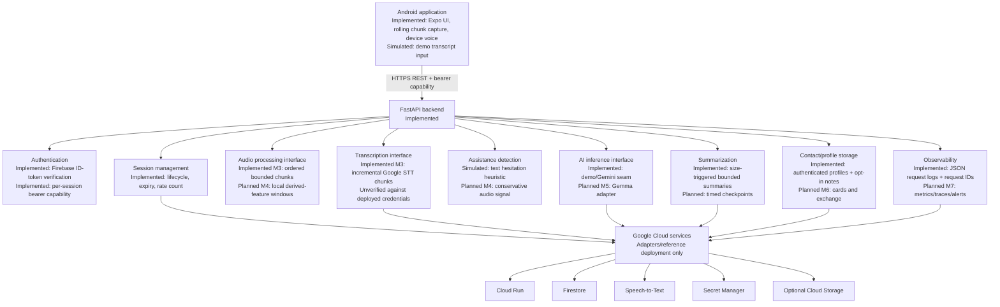
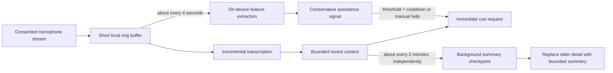

# Co-Wingman Architecture

## Status legend

- **Implemented:** present in the repository and covered at least partly by local tests.
- **Simulated:** deterministic demo behavior, explicitly not a production capability.
- **Planned:** an intended boundary or workflow for a later milestone; not claimed to work.

## Current runtime

With Firebase configured, the Expo client persists its Firebase sign-in, sends an ID token to profile routes and session creation, and receives a separate session capability for conversation operations. The backend verifies the ID token and uses its UID for profile and contact-note ownership. Demo mode replaces this with a persistent local device capability and is explicitly non-production.

In live mode, M3 gates microphone capture on participant-awareness confirmation and permission, then records ordered four-second M4A/WebM files. Uploads are serialized while capture rolls forward; successful transcripts enter the same bounded-context path as typed fragments. Chunk indexes make accepted retries idempotent. Device speech reads cues on Android and web without exposing a session capability in an audio URL.

The FastAPI application hashes session tokens before persistence, enforces a two-hour session expiry and per-session request count, and stores state through SQLite in demo mode or Firestore when configured. Active context consists of a bounded summary plus recent fragments. Cue generation uses deterministic demo rules by default or the current Gemini adapter in live mode. The `INFERENCE_PROVIDER` boundary reserves a distinct Gemma adapter; selecting Gemma currently fails closed because changing only a model name would not be a valid integration.

The backend remains one deployable service. This is intentional for a hackathon: internal module boundaries allow replacement without adding network hops, distributed transactions, or additional operations work.

## Service boundaries

| Boundary | Current implementation | Later evolution |
|---|---|---|
| Client/API | REST from one Expo screen plus isolated rolling-audio hook | Native PCM/WebSocket transport only if device testing justifies it |
| Identity | Firebase Authentication when configured; persistent demo device capability locally; separate session token | OAuth providers, account deletion, and stronger device secret storage |
| Session storage | SQLite or Firestore record adapter in `main.py` | Extract a repository when profile/session schemas evolve |
| Transcription | Ordered near-real-time chunks to Google Speech-to-Text V2 | Physical-device validation; optional native raw stream later |
| Assistance signal | Transcript hesitation and caller-provided pause count | Local, non-clinical audio feature pipeline in M4 |
| Inference | Deterministic demo cues or Gemini JSON response | Provider-specific Gemma implementation in M5 |
| Summary | Keyword summary in demo; provider summary in live mode | Timed checkpoints and final summary orchestration |
| Contact/profile data | UID-isolated professional profile, hashed contact lookup, opt-in topic summary | Cards, QR and compatible NFC in M6 |
| Telemetry | JSON request completion/failure events | OpenTelemetry metrics/traces and cloud dashboards in M7 |

## Future real-time pipeline

Audio capture and summarization have different clocks and must not block each other:

The four-second path should remain local where practical and emit only derived values, not raw audio telemetry. A manual help action bypasses automatic detection. Cue requests use the freshest bounded context immediately; they never wait for the two-minute checkpoint. Checkpoint work runs independently, merges atomically into session context, and must tolerate retries. Thresholds, cooldowns, and window sizes remain configurable and require device validation in later milestones.

## Data lifecycle

Raw uploaded audio is held in memory and cleared after the request. Recent transcript fragments remain in active session storage until they are summarized or the session ends. Session records receive a Firestore TTL field in live mode; SQLite demo files persist until the local database is removed. Profiles and opt-in contact notes persist until their respective deletion actions. Deleting a profile does not delete the Firebase account or conversation records. Provider-side retention is controlled by provider policy and is not guaranteed by this code.

## Milestone sequence

M1 established the foundation; M2 added Firebase authentication and profiles; M3 added rolling audio, incremental transcription, and device voice; M4 implements conservative assistance signals; M5 adds Gemma; M6 adds digital identity/contact exchange; M7 completes telemetry, privacy controls, and deployment; M8 integrates and validates the demo end to end.
