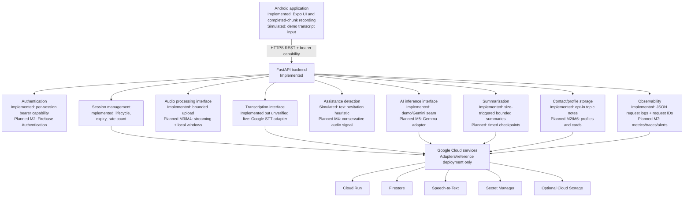
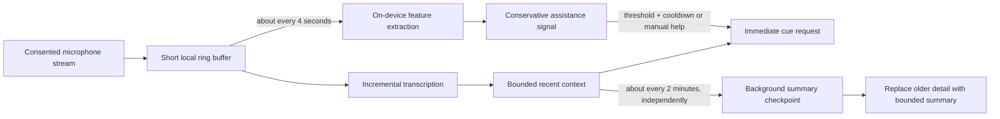

# Co-Wingman Architecture

## Status legend

- **Implemented:** present in the repository and covered at least partly by local tests.
- **Simulated:** deterministic demo behavior, explicitly not a production capability.
- **Planned:** an intended boundary or workflow for a later milestone; not claimed to work.

## Current runtime

The Expo client creates a session and keeps the returned bearer capability in component state. Each session operation sends that token. The FastAPI application hashes tokens before persistence, enforces a two-hour session expiry and per-session request count, and stores state through SQLite in demo mode or Firestore when configured. Active context consists of a bounded summary plus recent fragments. Cue generation uses deterministic demo rules by default or the current Gemini adapter in live mode. The `INFERENCE_PROVIDER` boundary reserves a distinct Gemma adapter; selecting Gemma currently fails closed because changing only a model name would not be a valid integration.

The backend remains one deployable service. This is intentional for a hackathon: internal module boundaries allow replacement without adding network hops, distributed transactions, or additional operations work.

## Service boundaries

| Boundary | Current implementation | Later evolution |
|---|---|---|
| Client/API | REST from one Expo screen | More focused client modules and streaming transport where justified |
| Identity | Random device owner capability plus session token | Firebase Authentication and durable user identity in M2 |
| Session storage | SQLite or Firestore record adapter in `main.py` | Extract a repository when profile/session schemas evolve |
| Transcription | Completed audio upload to Google Speech-to-Text V2 | Incremental/streaming flow in M3 |
| Assistance signal | Transcript hesitation and caller-provided pause count | Local, non-clinical audio feature pipeline in M4 |
| Inference | Deterministic demo cues or Gemini JSON response | Provider-specific Gemma implementation in M5 |
| Summary | Keyword summary in demo; provider summary in live mode | Timed checkpoints and final summary orchestration |
| Contact data | Hashed lookup key and opt-in topic summary | Profiles, cards, QR and compatible NFC in M6 |
| Telemetry | JSON request completion/failure events | OpenTelemetry metrics/traces and cloud dashboards in M7 |

## Future real-time pipeline

Audio capture and summarization have different clocks and must not block each other:

The four-second path should remain local where practical and emit only derived values, not raw audio telemetry. A manual help action bypasses automatic detection. Cue requests use the freshest bounded context immediately; they never wait for the two-minute checkpoint. Checkpoint work runs independently, merges atomically into session context, and must tolerate retries. Thresholds, cooldowns, and window sizes remain configurable and require device validation in later milestones.

## Data lifecycle

Raw uploaded audio is held in memory and cleared after the request. Recent transcript fragments remain in active session storage until they are summarized or the session ends. Session records receive a Firestore TTL field in live mode; SQLite demo files persist until the local database is removed. Contact notes persist only after explicit opt-in and have an API deletion path. Provider-side retention is controlled by provider policy and is not guaranteed by this code.

## Milestone sequence

M2 adds account authentication and profiles; M3 establishes reliable audio/transcription; M4 implements conservative assistance signals; M5 adds Gemma; M6 adds digital identity/contact exchange; M7 completes telemetry, privacy controls, and deployment; M8 integrates and validates the demo end to end.
